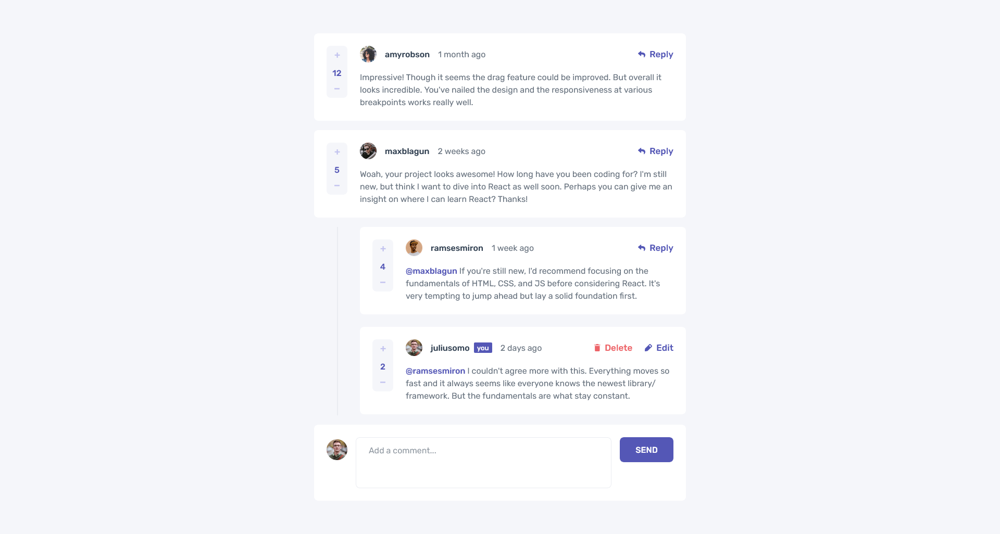
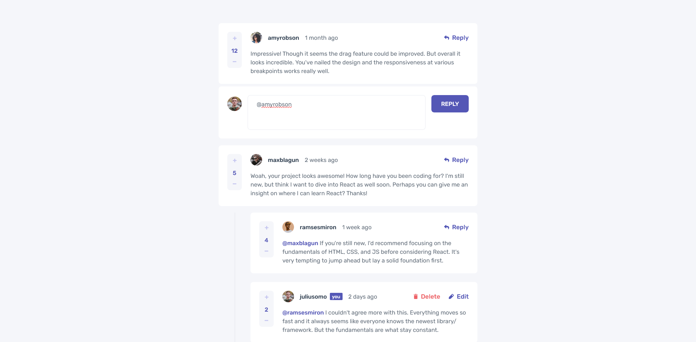
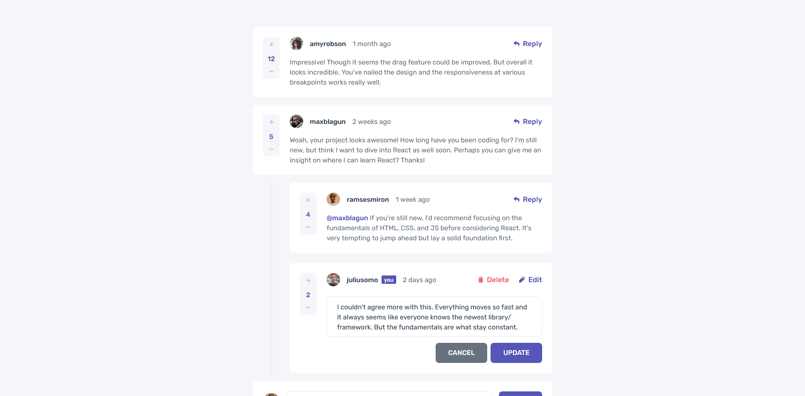

# Frontend Mentor - Interactive Comments Section Solution

This is a solution to the [Interactive Comments Section challenge on Frontend Mentor](https://www.frontendmentor.io/challenges/interactive-comments-section-iG1RugEG9). Frontend Mentor challenges help you improve your coding skills by building realistic projects.

## Table of contents

- [Overview](#overview)
  - [The challenge](#the-challenge)
  - [Screenshot](#screenshot)
  - [Links](#links)
- [My process](#my-process)
  - [Built with](#built-with)
  - [What I learned](#what-i-learned)
- [Author](#author)

## Overview

### The challenge

Users should be able to:

- View the optimal layout for the app depending on their device's screen size
- See hover states for all interactive elements on the page
- Create, Read, Update, and Delete comments and replies
- Upvote and downvote comments
- **Bonus**: Dynamically track the time since the comment or reply was posted using mixed timestamp/relative time formats.

### Screenshot

<table>
  <tr>
    <td align="center"></td>
    <td align="center"></td>
  </tr>
  <tr>
    <td align="center"></td>
    <td align="center"></td>
  </tr>
</table>

### Links

- [Solution URL](https://github.com/Kking927/interactive-comments-section)
- [Live Site URL](https://kking927.github.io/interactive-comments-section/)

## My process

### Built with

- Semantic HTML5 markup
- CSS custom properties & Flexbox
- Mobile-first workflow
- JavaScript (ES6+)
- Supabase - Backend & Database

### What I learned

Working through this project provided practical experience integrating a cloud database with dynamic DOM rendering:

- **Database Integration with Supabase**: Configured Supabase to persist user comments, replies, and vote counts, replacing local state.
- **Dynamic HTML Generation**: Rendered nested comment threads programmatically using vanilla JavaScript based on fetched database payloads.
- **Handling Mixed Date Formats**: Built custom logic to display both static legacy date strings from initial data and dynamic relative timestamps for new entries.
- **Data Seeding**: Practiced migrating initial local data (`data.json`) directly into a relational database.

## Author

- Frontend Mentor - [@Kking927](https://www.frontendmentor.io/profile/Kking927)
- GitHub - [Kking927](https://github.com/Kking927)
